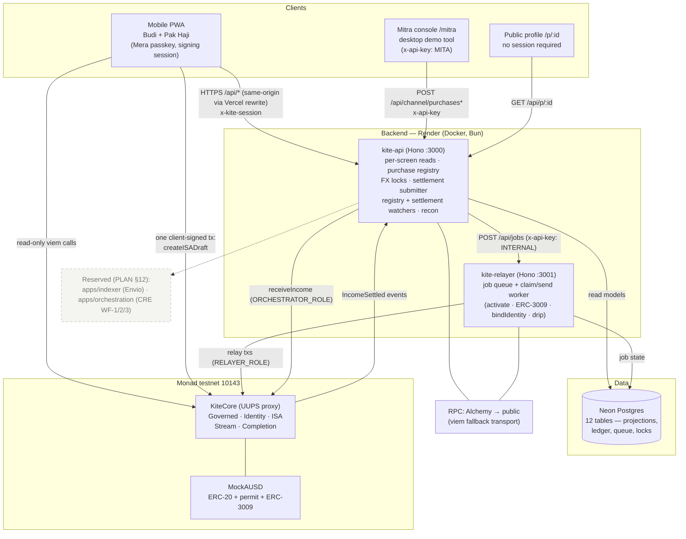
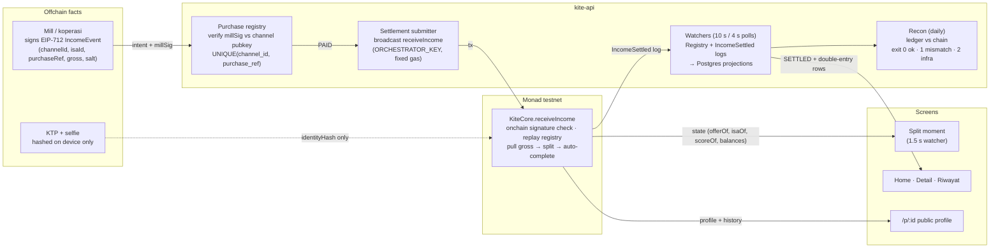
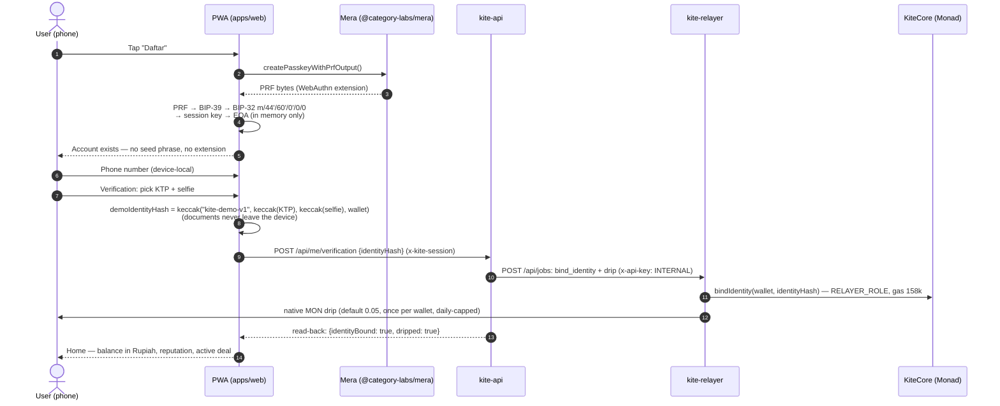
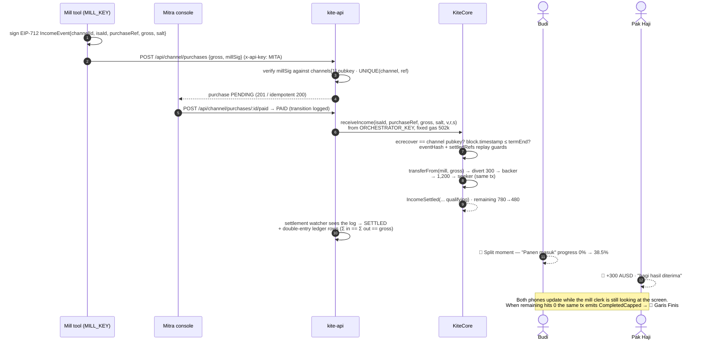
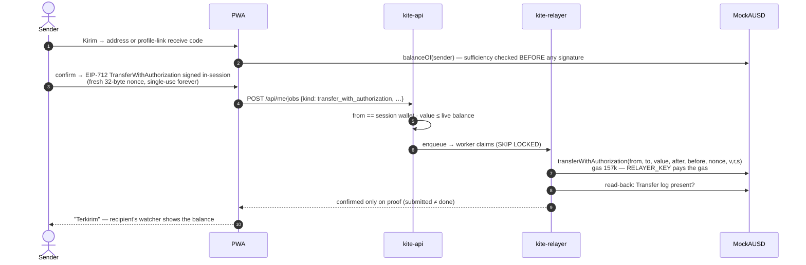
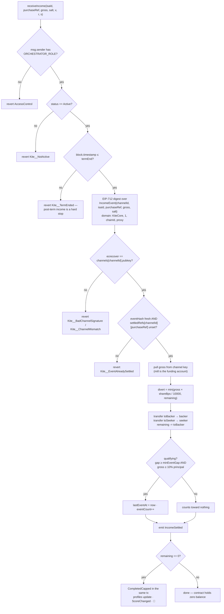
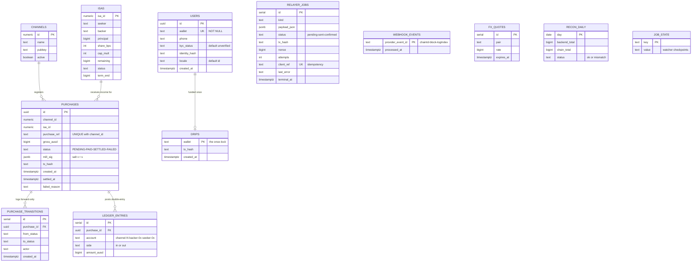
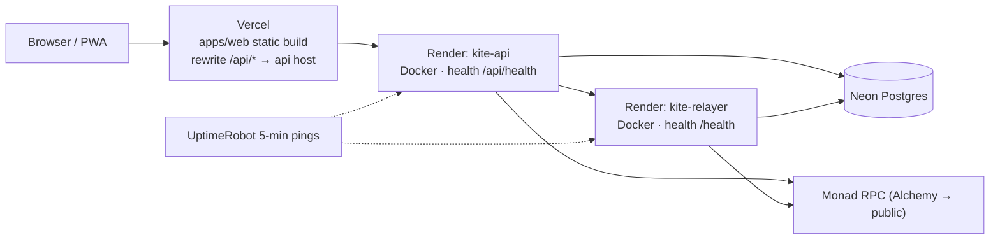

# Kite — Fund a person, not a loan

> **The money splits at the exact moment income arrives — and every financing ends.**
> A backer funds working capital today. A fixed share of every future harvest is diverted automatically, inside the same transaction that pays the income. When the cap is reached, the deal is done — forever.

Kite is an **income-share settlement protocol** for smallholder farmers, built on **Monad testnet** (chain `10143`) and settled in **AUSD**. It was built for the [Monad Metropolis](https://monad.xyz/developers/hackathons/metropolis) hackathon (Track 02: Consumer Products & Payments), and every part of it — contracts, backend, and app — is implemented and running on testnet.

| | |
|---|---|
| **Live app** | <https://kite-zeta.vercel.app> (mobile PWA — judge walkthrough in [JUDGES.md](JUDGES.md)) |
| **KiteCore (UUPS proxy)** | [`0x3B6C79756efa8d13e4beA36F323F8aC67774C0fD`](https://testnet.monadscan.com/address/0x3B6C79756efa8d13e4beA36F323F8aC67774C0fD) |
| **Settlement asset (MockAUSD, demo)** | [`0x0309764915AFC7a2a7CDd1E64c58a57c1F1705E3`](https://testnet.monadscan.com/address/0x0309764915AFC7a2a7CDd1E64c58a57c1F1705E3) |
| **Network** | Monad testnet · chain ID `10143` · [explorer](https://testnet.monadscan.com) |
| **API / Relayer** | <https://kite-api-ghoi.onrender.com> · <https://kite-relayer.onrender.com> |
| **Trust disclosures** | [TRUST.md](TRUST.md) — what is trustless, what is a demo tool, stated plainly |

---

## Table of contents

1. [Background & motivation](#background--motivation)
2. [Problem statement](#problem-statement)
3. [Proposed solution — problems solved](#proposed-solution--problems-solved)
4. [Value proposition & unique selling points](#value-proposition--unique-selling-points)
5. [Target users & real-world use cases](#target-users--real-world-use-cases)
6. [Key features](#key-features)
7. [Implementation status](#implementation-status)
8. [Technology stack](#technology-stack)
9. [System architecture](#system-architecture)
10. [Core business logic](#core-business-logic)
11. [Data flow](#data-flow)
12. [Application workflows](#application-workflows)
13. [Smart contracts](#smart-contracts)
14. [API reference](#api-reference)
15. [Database design](#database-design)
16. [Security considerations](#security-considerations)
17. [Getting started](#getting-started)
18. [Environment configuration](#environment-configuration)
19. [Local development setup](#local-development-setup)
20. [Deployment](#deployment)
21. [Repository layout](#repository-layout)
22. [Documentation map](#documentation-map)

---

## Background & motivation

**Budi, 41**, grows rice on one hectare in Ngawi, East Java. His income arrives in **two lumps a year** (~Rp 24 jt per harvest, sold to the local mill). Inputs — seed, fertilizer, labor — are due **before planting**, when his balance is zero.

- **Banks won't lend to him.** No payslip, no formal land title, no credit history — and a fixed monthly installment is mathematically impossible in a zero-income month.
- **His actual lender is the *tengkulak*** (the middleman): "$600 now, and you sell me your harvest at my price" — roughly 20% under market, with the debt rolling into next season's inputs. **It is designed to never end.**
- What Budi *does* have is a smartphone running GoPay/OVO/Dana, a real income stream (harvests), and a community — including diaspora family abroad who already send money home as help that never returns.

**Why onchain rails?** A bank restructuring repayment per-sale at a $600 ticket size is uneconomical — the field officer costs more than the interest. Kite puts the repayment **inside the settlement itself**: the split executes atomically in the same transaction the harvest payment arrives, enforced by contract state nobody can bend. And the finished record is public and portable — it follows Budi to the next mill, the next village, the next backer. Monad makes this viable economically: settlement is instant and fees are ~$0.0005 per transaction, so the split lands on both phones while the mill clerk is still looking at the screen.

## Problem statement

| # | Problem | Consequence today |
|---|---|---|
| P1 | Income arrives in two lumps a year; expenses are due months earlier | Farmers borrow at predatory terms before every planting season |
| P2 | Repayment schedules assume steady monthly income | Fixed installments are impossible in zero-income months; default machinery and collateral follow |
| P3 | The informal lender's terms (discount + rollover) have no finish line | Debt becomes permanent, season after season |
| P4 | No credit history is recorded anywhere portable | Each lender starts from zero; good farmers pay new-borrower prices forever |
| P5 | Per-sale repayment enforcement is uneconomical for formal finance at $600 tickets | Nobody serves this segment; the tengkulak is the only game in town |

## Proposed solution — problems solved

Kite formalizes ***bagi hasil*** — the profit-sharing arrangement that already exists informally across rural Indonesia — into an onchain agreement whose enforcement is the settlement itself:

- **The split is atomic with income receipt.** When the mill pays for a harvest, one transaction (`receiveIncome`) pulls the gross from the mill, diverts the agreed share to the backer, and pays the remainder to the farmer. There is no state where income sits unsplit. Nothing to dodge, nothing to chase, no collector. *(solves P2, P5)*
- **Fairness is physics, not policy.** Predatory terms cannot be written: the contract reverts unless the share is ≤ 20%, the cap multiplier is within [1.2×, 1.5×], the term is ≤ 24 months, and the principal fits the farmer's earned offer. *(solves P1, P2)*
- **Every financing ends.** The cap is fixed at signing (`principal × capMult`); when cumulative diversions reach it, the deal completes automatically in the same settlement transaction. A failed harvest diverts **zero** — and whatever remains at term end is forgiven, permissionlessly. There is no default state to fall into. *(solves P3)*
- **The record is the credit history.** Reputation (0–100) is computed by a pure, hand-checkable library and changes only when a deal completes. The public profile page (`/p/:id`) shows stars, completed deals, and per-harvest history — no name, no documents — and its links carry a funding request to any backer. *(solves P4)*

## Value proposition & unique selling points

1. **Settlement-level repayment, not collection.** Repayment rides the income transaction itself — the only mechanism that works at $600 ticket sizes, where any field-officer-based model loses money.
2. **A finish line.** The 🎉 *Selesai* screen is the business model made visible. The tengkulak never shows that screen.
3. **Predation is unwritable, not forbidden.** Share/cap/term bounds are enforced in contract code at draft time — no competitor can outbid them, because it isn't a pricing decision.
4. **Forgiveness as a first-class state.** Failed harvest → 0 diverted; term end → remainder forgiven, callable by anyone. Humane by design and honest: the backer's accepted risk is stated on the deal card ("this is not a bond").
5. **Invisible crypto.** Passkey signup (Mera), gasless user actions (ERC-2612 permit / ERC-3009 transfer-with-authorization relayed by the backend), a relayer that drips fee MON invisibly after verification. No seed phrase, no extension, no token to buy. User-facing screens speak only *Bagi Hasil, Dukung, Partner, Lunas, Selesai* — never wallet, gas, chain, token.
6. **Portable, self-sovereign reputation.** Score and offer live in the contract, recomputable by anyone; the public profile is a referral asset that re-derives from the chain.

## Target users & real-world use cases

**First segment** (named, reachable, existing behavior): smallholder rice farmers in the Ngawi/Madiun corridor of East Java, financed by family diaspora in Malaysia — a *bagi hasil* behavior that already exists and that Kite formalizes rather than invents.

| User | Role in Kite | Real-world use case |
|---|---|---|
| **Budi** (farmer) | *Seeker* | Applies for working capital before planting ("Ajukan"), receives principal instantly, keeps every harvest payment minus the agreed share, watches progress to the finish line, sends AUSD to family gaslessly, shares a public profile link as his record |
| **Pak Haji** (diaspora in KL) | *Backer* | Opens `kite.id/p/budi`, sees reputation and completed deals, funds Rp 9.6 jt in one biometric tap, receives 20% of each harvest automatically until the capped total returns, then it's done — without ever asking for his money back |
| **The mill / koperasi** | *Channel* (Mitra console) | Records today's purchases (Kite and non-Kite rows), marks them paid, and forwards settlement — the onchain version of the field officer |
| **The next lender** | *Anyone* | Reads `/p/:id` — stars, completed count, per-harvest history, onchain proofs — and prices the next season's offer from `offerOf()` |

**Scale path:** 1 rice mill + 2 koperasi pilots onboard farmers from a tablet; diaspora WhatsApp communities supply backers. After the hackathon: licensed fiat rails via the OJK Regulatory Sandbox (POJK 3/2024), then the same settlement engine for salaries → freelance payouts → SME invoices.

## Key features

**For farmers and backers**
- **Passkey account** — one biometric ceremony derives the account silently (Mera PRF → secp256k1 key → EOA). Sign-in on a new day is one tap; the key never leaves the device.
- **Demo verification** — KTP + selfie hashed locally (documents never leave the phone); approval auto-completes and the backend binds `identityHash → wallet` onchain and drips fee MON invisibly.
- **Ajukan (apply)** — the farmer's one client-signed transaction: a *directed draft* naming the intended backer, with terms validated against contract bounds and the farmer's live offer.
- **Dukung (back)** — the backer signs an ERC-2612 permit; the relayer funds, pulls, and activates in a single transaction. One paragraph of agreement: share · cap · "harvest fails → 0 taken" · end date.
- **The split moment** — when settlement lands, both phones show a full-screen moment: gross in, two split cards, progress jump. Driven by a 1.5 s dual watcher (API poll for the seeker, direct contract reads for the backer).
- **Kirim (send)** — gasless AUSD transfers to any Kite address or profile-link "receive code" via ERC-3009, signed in-session, relayed, confirmed only after an on-chain balance read-back.
- **Garis Finis 🎉** — completion: confetti, season stats, reputation jump (58 → 91 in the demo), next-offer teaser.
- **Public profile `/p/:id`** — stars, completed count, per-ISA history with explorer links, and an optional `?ajukan=` deep link that carries the farmer's funding request as text.

**For operators**
- **Mitra console `/mitra`** (desktop, labeled "Demo Tool") — purchase registry with today's rows, split preview, mark-paid; the settlement broadcast is a separate, auditable step.
- **Relayer** — INTERNAL-keyed job queue: activate-with-permit, ERC-3009 sends, identity binding, MON drips. Fixed gas limits, proof-gated confirmation, capped daily outflow.
- **Reconciliation** — daily ledger-vs-chain comparison with a three-valued exit code; mismatches are recorded, never repaired.

## Implementation status

Everything below is **implemented and running on Monad testnet** — this table is the honest map of the repo:

| Component | Status | Where |
|---|---|---|
| `KiteScoring` + split math (pure libraries) | ✅ Done — 21 tests, hand-checked literals | `contracts/src/KiteScoring.sol` |
| `KiteCore` UUPS (Governed · Identity · ISA · Stream · Completion) | ✅ Done — deployed, verified, 65 tests + 12 invariants | `contracts/src/` |
| `MockAUSD` (ERC-20 + permit + ERC-3009) | ✅ Done — live as the demo settlement asset | `contracts/src/MockAUSD.sol` |
| Testnet deployment + seeded demo state | ✅ Done — published to `@kite/contracts` | `contracts/script/`, `packages/contracts/` |
| API (per-screen reads, purchase registry, FX, settlement submitter, watchers, recon) | ✅ Done — running on Render | `apps/api/` |
| Relayer (job queue + worker: activate, ERC-3009, bindIdentity, drip) | ✅ Done — running on Render | `apps/relayer/` |
| Consumer PWA (signup → verification → home → deal → split → finish; Dukung, Kirim, Riwayat, `/p/:id`, `/mitra`) | ✅ Done — running on Vercel | `apps/web/` |
| Envio indexer | ⏳ **Reserved workspace** — PLAN §12 day 10 (chain reads today are direct viem RPC + Postgres projections) | `apps/indexer/` (stub) |
| Chainlink CRE workflows (WF-1/2/3) | ⏳ **Reserved workspace** — PLAN §7.5 (settlement submission today is the API's `submit-settlement`, relayer transports user jobs) | `apps/orchestration/` (stub) |

## Technology stack

| Layer | Technology | Version / notes |
|---|---|---|
| Contracts | Solidity + Foundry | `pragma ^0.8.20`, built with solc 0.8.36 (Prague), `via_ir`, optimizer 200 runs (KiteCore is 28,367 bytes — over the EIP-170 limit without it) |
| Contracts libs | OpenZeppelin Upgradeable | v5.7.0 (ERC-7201 namespacing, UUPS, AccessControl, EIP-712, ReentrancyGuard) |
| Runtime | Bun | 1.4.2 — one runtime for API, relayer, tests, and scripts |
| API framework | Hono | `Bun.serve`, hostname `0.0.0.0` |
| Chain access | viem | ^2.37 (resolved 2.57.4), `monadTestnet` chain, Alchemy-first fallback transport |
| Database | Postgres (Neon) + Drizzle ORM | `drizzle-orm` 0.44.x, Neon serverless HTTP driver; PGlite for tests |
| Frontend | React + Vite + Tailwind | React 19.3, Vite 7.3, Tailwind CSS 4 (CSS-first `@theme`), `vite-plugin-pwa` |
| Accounts | `@category-labs/mera` | 0.2.0 — passkey with PRF output → derived secp256k1 signing session |
| Key derivation | `@scure/bip32` + `@scure/bip39` | 2.4.0 — PRF → mnemonic → `m/44'/60'/0'/0/0` |
| Build orchestration | Turborepo + Biome | 9 workspaces, Biome 2.3 at the root |
| Hosting | Vercel (web) · Render Docker (api + relayer) · Neon (Postgres) | `render.yaml` blueprint; Vercel `/api/*` rewrite keeps the browser same-origin |
| Chain | Monad testnet | chain `10143`, RPC `https://testnet-rpc.monad.xyz`, Alchemy endpoint optional and preferred |

## System architecture



### Component responsibilities

| Component | Responsibility | Does **not** do |
|---|---|---|
| `contracts/` (KiteCore, MockAUSD) | The only authority: terms bounds, escrow, split, replay protection, score, terminal states, roles, asymmetric pause | No FX, no identity documents, no scheduling |
| `apps/web` | All user surfaces; local crypto (PRF derivation, EIP-712 signing, identity hashing); optimistic UI with 1.5 s watchers | No key custody beyond the in-memory session; no server trust for balances |
| `apps/api` | Per-screen JSON; purchase registry + mill-signature verification; FX lock rows; settlement broadcast; Postgres projections via log watchers; recon job | Never holds user keys; never repairs ledger mismatches |
| `apps/relayer` | One queue + one worker; broadcasts relayer txs at published fixed gas limits; proof-gated confirmation; drip budget | No business logic — payload validators only; one tx in flight per key |
| `packages/contracts` | Generated ABIs, deployed addresses (`KITE_DEPLOYMENT`), published gas limits — CI-checked single source of truth | — |
| `packages/core` | Shared schema (Drizzle), RPC priority, FX constants, constant-time auth helpers | — |

## Core business logic

All economics live in `contracts/src/KiteScoring.sol` — a **pure, integer-only library** (floors everywhere, hand-checkable). The test suite asserts the exact numbers below as literals.

### Score (0–100) — changes only on completion

```
History      = 40 × completed × min(totalISAs, 3) / (totalISAs × 3)
               (capped at 13 if distinctBackers < 2 — one backer can never fund a full record)
Consistency  = 20 × min(qualEvents, 12) / 12
Volume       = 40 × min(qualEvents, 6) / 6
score        = History + Consistency + Volume        (integer floor per component)

offerOf(s)   = 600 AUSD × (100 + 2×s) / 100          (max principal the farmer may request)
share guide  = 2000 − 8×s bps                      (UI guidance only)
```

**A qualifying event** is an income settlement that is channel-signed, ≥ `minEventGap` after the previous qualifying event, and gross ≥ 10% of the ISA's principal. Non-qualifying events still split normally — they just count toward nothing (anti-farming).

Demo numbers (asserted literally in `contracts/test/KiteCore.t.sol`):

| State | total | completed | backers | qualEvents | History | Consistency | Volume | **Score** | maxP |
|---|---|---|---|---|---|---|---|---|---|
| New account | 0 | 0 | 0 | 0 | 0 | 0 | 0 | **0** | 600 AUSD |
| Budi, seeded (2 ISAs done) | 2 | 2 | 2 | 4 | 26 | 6 | 26 | **58** | 1,296 AUSD |
| After the demo ISA completes | 3 | 3 | 3 | 7 | 40 | 11 | 40 | **91** | 1,692 AUSD |

### The split — atomic inside `receiveIncome`

```
slice     = gross × shareBps / 10000
toBacker  = min(slice, remaining)        (cap is a hard ceiling)
toSeeker  = gross − toBacker             (conservation holds exactly, same tx)
```

Demo ISA (principal 600, share 20%, cap 1.3× → 780 AUSD) — the seeded live state is after Panen 1, remaining 480:

| Event | Gross | To backer | To seeker | Remaining | Progress |
|---|---|---|---|---|---|
| Activation | – | – | 600 (principal out) | 780 | 0% |
| Panen 1 | 1,500 | 300 | 1,200 | 480 | 38.5% ← **seeded live state** |
| Panen 2 | 1,500 | 300 | 1,200 | 180 | 76.9% |
| Panen 3 | 1,500 | **180** (cap reached) | 1,320 | 0 → **CompletedCapped** 🎉 | 100% |

### Contract-enforced bounds (`createISADraft`)

`shareBps ∈ [1000, 2000]` · `capMult ∈ [120, 150]` · `termEnd ≤ now + 730 days` · `principal ≤ offerOf(seeker)` · channel active · seeker has no active ISA · both parties identity-bound · **drafts are directed** — the named backer must be the permit signer at activation (`Kite__WrongBacker` otherwise). Terms outside these bounds revert at creation: a predatory deal is *unwritable*.

## Data flow



Two things to note in this flow:

- **The chain is the authority; Postgres is only an index.** Every value the API serves about money is re-readable from the contract; the DB exists for per-screen speed, the purchase registry, and the append-only ledger. The web watcher even reads the backer side directly from the contract, bypassing the API.
- **The mill's signature is verified twice.** Once offchain by the API at registry time (fail fast) and once onchain by `KiteCore` at settlement (fail closed) — a forged registry entry cannot split without the mill's key.

## Application workflows

### 1 · Onboarding — stranger to working account, no crypto plumbing



The session itself is a signed proof, not a cookie: the wallet signs the frozen message `Sign in to Kite\n<wallet>\nuntil <until>` and the app sends `x-kite-session: wallet|until|v|r|s`. The API recovers the signer locally (no RPC), caps the TTL at 7 days, and needs no session store.

### 2 · Funding — directed draft → permit → one-tx activation

```mermaid
sequenceDiagram
    autonumber
    actor S as Budi (seeker)
    actor B as Pak Haji (backer)
    participant W as PWA
    participant A as kite-api
    participant R as kite-relayer
    participant K as KiteCore
    participant T as MockAUSD

    S->>K: createISADraft(terms, backer) — the seeker's own client-signed tx<br/>(bounds checked vs offerOf; dripped MON pays gas)
    K-->>S: ISADrafted(isaId) — status Drafted
    B->>W: opens /p/budi?ajukan=… → "Dukung" Rp 9.6 jt
    W->>B: one-paragraph agreement: 20% share · 780 cap ·<br/>"panen gagal? 0 diambil" · end date
    B->>W: Face ID → sign ERC-2612 permit (principal 600, TTL 600 s)
    W->>A: POST /api/me/jobs {kind: activate_with_permit, v,r,s}
    A->>A: live caps: ISA must be Drafted · offer ≥ principal
    A->>R: enqueue (x-api-key: INTERNAL, idempotent clientRef)
    R->>T: permit(backer → KiteCore, 600)
    R->>K: activateWithPermit(isaId, deadline, v,r,s) — gas 346k
    K->>T: transferFrom(backer, KiteCore, 600) → transfer(seeker, 600)
    K-->>W: ISAActivated(isaId, backer, 600)
    W-->>S: "Dukungan diterima · Rp 9,6 jt" (watcher ≤ 1.5 s)
    Note over K,T: Escrow conservation is exact: principal in == principal out,<br/>the contract never holds a balance across transactions
```

### 3 · Harvest day — the split moment (the product)



### 4 · Gasless send (Kirim) — ERC-3009 with no MON in the user's wallet



## Smart contracts

Foundry workspace at `contracts/`. `KiteCore` is a **UUPS proxy built from ERC-7201-namespaced modules** — one address for the app, the scripts, and `/p/:id`; a module can change without shifting another's storage.

### Contracts

| Contract | Contents |
|---|---|
| `KiteCore.sol` | UUPS implementation; `initialize(admin, relayer, orchestrator, pauser, ausd, minEventGapSec)`; all views; upgrade authority = `DEFAULT_ADMIN_ROLE` |
| `modules/Governed.sol` | Roles, **asymmetric pause** (blocks `createISADraft`/`activateWithPermit` only — income and forgiveness never stop), init-once `minEventGap` (no setter exists) |
| `modules/Identity.sol` | `bindIdentity(wallet, identityHash)` (RELAYER_ROLE, one-to-one both ways, immutable), channel registry `registerChannel(id, name, pubkey)` (ADMIN, write-once) |
| `modules/ISA.sol` | `Terms`/`ISA` structs, status constants, directed drafts, bounds, `activateWithPermit`, `cancelDraft`, the single completion site `_completeInternal` |
| `modules/Stream.sol` | `receiveIncome` (EIP-712 channel-fact verification, double replay registry, atomic split), `flagMismatch` (emit-only) |
| `modules/Completion.sol` | `completeAtTerm` — permissionless after `termEnd`, idempotent, forgives the remainder, **not pausable** |
| `KiteScoring.sol` | Pure library: `score`, `offerOf`, `divert`, `isQualifyingEvent` |
| `MockAUSD.sol` | 6-decimal ERC-20 demo asset with ERC-2612 permit + hand-rolled EIP-3009 `transferWithAuthorization`; 1,000,000 AUSD minted once to the deployer. Swapping in real AUSD is a deployment parameter, not a code change |

### Key function surface

| Function | Who | Notes |
|---|---|---|
| `createISADraft(Terms, backer)` | seeker (identity-bound) | Full bounds check vs `offerOf`; one active ISA per seeker; emits `ISADrafted` |
| `activateWithPermit(isaId, deadline, v,r,s)` | permissionless — the backer's permit is the authorization | `WrongBacker` pre-check → `permit` → `transferFrom` → `transfer` → Active; emits `ISAActivated`; `nonReentrant` |
| `receiveIncome(isaId, purchaseRef, gross, salt, v,r,s)` | ORCHESTRATOR_ROLE | Onchain EIP-712 verification against the channel pubkey; `eventHashes` + `settledRefs` replay guards; `block.timestamp ≤ termEnd`; atomic pull → split → auto-complete; emits `IncomeSettled(isaId, channelId, purchaseRef, gross, toBacker, toSeeker, remaining, qualifying)` |
| `completeAtTerm(isaId)` | anyone, after `termEnd` | Remainder forgiven; terminal; emits `ISACompletedAtTerm` + `ScoreChanged` |
| `cancelDraft(isaId)` | seeker or named backer | Drafted only; not pause-gated |
| `bindIdentity(wallet, identityHash)` | RELAYER_ROLE | Reverts if the hash is bound to another wallet |
| `flagMismatch(day, expected, actual)` | ORCHESTRATOR_ROLE | Emits `MismatchFlagged`; no state change |
| `pause()` / `unpause()` | PAUSER_ROLE | Asymmetric — new risk stops; settlement and forgiveness never do |
| views: `isaOf · profileOf · scoreOf · offerOf · channelOf · identityOf · walletOfIdentity · activeISA · ausd · minEventGap` | open | The entire app reads from these |

### receiveIncome decision flow



### Tests and invariants

- **96 unit tests** — `KiteCore.t.sol` (65: literal §6.3 numbers, draft/identity/cancel/income/complete boundaries, roles, asymmetric pause, reentrancy, upgrades, init), `KiteScoring.t.sol` (21: literals + fuzz conservation/monotonicity), `MockAUSD.t.sol` (10: permit + ERC-3009 paths incl. replay/expiry/forgery).
- **12 stateful invariants** (runs 32 × depth 64) over a 13-action bounded handler with ghost-state mirrors computed **independently of KiteScoring** — every violation counter must stay 0: split conservation, facts single-use (the handler actively replays settled facts), forged signatures never succeed, no income on terminal ISAs, identity one-to-one, terms within bounds, score ∈ [0,100] moving only on completion, qualifying-event accounting, escrow emptiness (`balanceOf(KiteCore) == 0`), asymmetric pause, reentrancy resistance, role confinement.

### Published deployment & gas

`packages/contracts` ships the CI-checked single source of truth: `KITE_DEPLOYMENT` (addresses, chain, explorer, `deployedAt`, `ausdIsMock: true`, `minEventGapSec: 60`), generated ABIs, and **fixed gas limits** (e.g. `activateWithPermit` 346k, `receiveIncome` 502k, `bindIdentity` 158k, ERC-3009 transfer 157k). Fixed limits matter on Monad because **gas is charged on the limit, not the gas used** — every relayer tx and the client's draft tx send a published constant, never an estimate.

> **Demo disclosures** (full table in [TRUST.md](TRUST.md)): the testnet deployment initializes `minEventGap` to **60 seconds** (production value: 60 days — init-once, visible onchain via `minEventGap()`) so seeded states are producible in minutes, and settles in **MockAUSD** (`ausdIsMock: true`), a stand-in mirroring real AUSD's permit + ERC-3009 surface. Seeded personas are pre-seeded EOAs wrapped by the demo phones' passkeys; judge signup is the pure passkey path.

## API reference

Two Hono services. All errors leave as `{ "error": { "code", "message" } }` — no stack traces, no key echo.

### kite-api (`:3000`, behind the Vercel same-origin `/api` rewrite in production)

| Method | Path | Auth | Purpose |
|---|---|---|---|
| GET | `/api/health` | – | Probes Postgres (`SELECT 1`) + RPC (chainId, block) → `ok` \| `degraded` |
| GET | `/api/quote?pair=USD_IDR\|USD_MYR` | – | Display-only FX lock (demo-fixed 16,000 / 4.150, TTL 60 s, rows in `fx_quotes`) |
| GET | `/api/me` | `x-kite-session` | One answer for the home screen: AUSD balance, identityBound, profile/score, active ISA, last 5 purchases |
| GET | `/api/me/verification` | `x-kite-session` | Read-back `{identityBound, dripped}` (chain + `drips` table) |
| POST | `/api/me/verification` | `x-kite-session` | `{identityHash}` → enqueues `bind_identity` + `drip` (idempotent `clientRef`s) |
| POST | `/api/me/jobs` | `x-kite-session` | Whitelisted relay forward: `activate_with_permit` (ISA Drafted + offer ≥ principal) or `transfer_with_authorization` (sender == session wallet, value ≤ live balance) → `202 {jobId, clientRef}` |
| GET | `/api/p/:id` | – | Public profile by identityHash or wallet: reputation from chain, deals + per-event history from the projection. No name, no documents |
| GET | `/api/channel/purchases` | `x-api-key` (MITA) | Registry read, latest 50 |
| POST | `/api/channel/purchases` | `x-api-key` (MITA) | Create intent — mill signature verified against the registered channel pubkey; idempotent per `(channel_id, purchase_ref)`; `201` created / `200` replay |
| GET | `/api/channel/purchases/:id` | `x-api-key` (MITA) | Single-purchase validation read |
| POST | `/api/channel/purchases/:id/paid` | `x-api-key` (MITA) | `PENDING → PAID` (the only authenticated money-state move over HTTP; transition logged) |

**Session auth:** the header `x-kite-session: wallet|until|v|r|s` is recovered locally via `recoverMessageAddress` over the frozen message `Sign in to Kite\n<wallet>\nuntil <until>`; declared signer must equal recovered signer; TTL ≤ 7 days with 60 s skew. Failures → `401 session_invalid` / `session_expired`.

### kite-relayer (`:3001`)

| Method | Path | Auth | Purpose |
|---|---|---|---|
| GET | `/health` | – | Liveness only |
| POST | `/api/jobs` | `x-api-key` (INTERNAL) | Enqueue — kind-validated at the edge (400, no row written); idempotent on `client_ref` (`202` new / `200` existing) |
| GET | `/api/jobs/:id` | `x-api-key` (INTERNAL) | Job status |

**Job kinds** (fixed gas limits from `@kite/contracts`; statuses `pending → sent → confirmed`, "failed" iff `terminal_at` set):

| Kind | Contract call | Gas | Confirmation proof |
|---|---|---|---|
| `activate_with_permit` | `KiteCore.activateWithPermit` | 346,000 | `isaOf(id).status == Active` |
| `transfer_with_authorization` | MockAUSD ERC-3009 | 157,000 | `Transfer(from,to,value)` log match |
| `bind_identity` | `KiteCore.bindIdentity` | 158,000 | `identityOf(wallet) == identityHash` |
| `drip` | native MON transfer | n/a | balance ≥ drip amount; `drips` PK is the once-lock; daily cap pre-checked |

Worker discipline: `SELECT … FOR UPDATE SKIP LOCKED` claims (stuck `sent` jobs first — crash recovery before new work); max 3 attempts with exponential backoff (500 ms → 8 s); nonce resynced from `eth_getTransactionCount(…, "pending")` on every send; `sent` + txHash recorded **before** receipt polling; a mined-success-without-proof is retryable, never confirmed; a `sent` job is re-broadcast only after its receipt + proof show the effect did not land.

## Database design

One Postgres (Neon) shared by both services; schema in `packages/core/src/db/schema.ts`, pushed by `bun run db:push`. **Every money column is an integer in AUSD base units (6 dp) — never a float.** The chain is the authority; these tables are projections, a registry, a queue, and append-only evidence.



**State machines and locks**

- `purchases.status`: `PENDING → PAID → SETTLED | FAILED`, forward-only (`PURCHASE_TRANSITIONS` logs every move, including rejected attempts as `rejected:<actor>`; rows are never deleted).
- Replay locks, three layers deep: `UNIQUE(channel_id, purchase_ref)` in Postgres, `webhook_events` PK (`"10143:<block>:<logIndex>"`) for log delivery, and the onchain `eventHashes`/`settledRefs` registry as the final authority.
- `ledger_entries` is append-only double-entry: the writer asserts Σ in == Σ out == gross per purchase.
- `relayer_jobs`: `pending → sent → confirmed`; "failed" is derived from `terminal_at IS NOT NULL` — no fourth status to drift out of sync.
- `recon_daily` is upserted per day; a mismatched day is **written, never repaired**.

## Security considerations

**Onchain (the trust anchor)**

- **Channel facts verified onchain.** `receiveIncome` recovers the EIP-712 signer and compares it to the registered channel pubkey — forgery reverts even if every offchain component is compromised. A leaked orchestrator key alone can settle nothing.
- **Double replay protection.** `keccak(channelId, purchaseRef, gross, salt)` in `eventHashes`, plus `settledRefs[channelId][purchaseRef]` — the same purchase can never settle twice, even with a fresh salt.
- **Directed drafts.** Activation reverts unless the permit signer is the named backer; drafts can't be hijacked or front-run into different deals.
- **Post-`termEnd` hard stop.** Income reverts after term end (equality allowed) — no last-harvest griefing window between term end and completion.
- **Escrow conservation.** Activation pulls exactly `principal` and pays exactly `principal`; settlement pulls exactly `gross` and pays exactly `gross`. `balanceOf(KiteCore) == 0` is a running invariant. Reentrancy guards on both entry points; ORCHESTRATOR/RELAYER roles have no path to contract funds.
- **Asymmetric pause.** `PAUSER_ROLE` can stop new drafts and activations; settlement, completion, and forgiveness keep working. New risk stops; obligations don't.
- **Roles are minimal and disjoint:** ADMIN (upgrade, registerChannel), RELAYER (`bindIdentity` only), ORCHESTRATOR (`receiveIncome`/`flagMismatch` only), PAUSER (`pause`/`unpause` only). Upgrades gated to ADMIN via `_authorizeUpgrade`.

**Offchain**

- **No key custody.** User keys are derived from the passkey PRF into an in-memory signing session; only a 7-day signed session proof (`x-kite-session`) reaches the server, and its blast radius is reads + relayer enqueue (bearer-like within its window — disclosed in [TRUST.md](TRUST.md), nonce binding is roadmap).
- **Secrets never enter code or git.** `RELAYER_KEY`, `ORCHESTRATOR_KEY`, `MILL_KEY`, `DEPLOYER_KEY`, `INTERNAL_API_KEY`, `MITA_API_KEY` are env-only; a missing variable aborts as `EnvMissing(NAME)` and nothing else. Service keys are compared constant-time (SHA-256 + `timingSafeEqual`).
- **Relayer blast radius.** Fixed minimum-role key, one tx in flight, proof-gated confirmation, daily native-outflow cap, drip once per verified wallet.
- **Documents never leave the device.** Demo verification hashes KTP + selfie locally; only the composite `identityHash` goes onchain.
- **Idempotency everywhere money moves.** Unique purchase refs, unique `client_ref`s, once-only drips, INSERT-ON-CONFLICT log dedup.
- **Reconciliation never repairs.** Daily ledger-vs-chain compare writes the verdict and exits non-zero on mismatch; `flagMismatch` onchain is the operator's public confession, not a fix.
- **Error hygiene.** Every error is `{error:{code,message}}`; unknown errors log server-side and return a bare `internal`; no key echo, no stack traces.

**Honest limits** (stated, not hidden — full table in [TRUST.md](TRUST.md)): the purchase registry is a centralized demo tool (a forged entry still cannot split without the mill's signature); mill+farmer collusion on under-reporting is an open problem (channel reputation + koperasi attestation are roadmap); a lost passkey is a lost account (synced passkeys mitigate; KYC-gated rebind is roadmap); regulation and Sharia certification are roadmap items — *bagi hasil* is structured as partnership, not credit, and the backer-risk "this is not a bond" line lives on the deal card itself.

## Getting started

### Prerequisites

| Tool | Version | Used for |
|---|---|---|
| [Bun](https://bun.sh) | 1.4.x | Workspaces, API, relayer, web, tests, scripts |
| [Foundry](https://book.getfoundry.sh) (`forge`, `cast`) | recent | Contracts build, tests, deploy/seed scripts |
| Postgres | any (Neon recommended) | `DATABASE_URL` for both backend services |
| Testnet MON | faucet | Only for deployer/relayer/orchestrator keys — end users never need it |
| (optional) Alchemy account | free tier | Calmer Monad RPC than the public endpoint (`ALCHEMY_RPC_URL`) |

### Install

```sh
git clone https://github.com/andrestudents/Kite.git
cd Kite
bun install                # all 9 workspaces
forge build --root contracts   # or: bun run build (turbo + forge)
```

Sanity-check the toolchain and workspace wiring:

```sh
bun run health    # prerequisites (bun, forge) + all 9 workspaces resolve
```

### Run the test suites

```sh
forge test --root contracts    # 96 unit + 12 invariants
bun test                       # packages, apps, scripts (includes recon + submit-settlement suites)
bun run lint                   # biome
bun run typecheck              # turbo
```

## Environment configuration

Copy the two example files and fill in values. Bun auto-loads `.env`; secrets never enter code or git — a missing variable aborts as `EnvMissing(<NAME>)`.

```sh
cp env.example .env            # backend (api + relayer + scripts)
cp apps/web/env.example apps/web/.env.local   # web (VITE_* are public by design)
```

### Backend — root `.env`

| Variable | Required | Purpose |
|---|---|---|
| `DATABASE_URL` | ✅ | Neon Postgres connection (shared by api + relayer; add `?sslmode=require` for Neon) |
| `ALCHEMY_RPC_URL` | – | Primary Monad RPC (wins over `RPC_URL`; public RPC stays wired as the viem fallback) |
| `RPC_URL` | – | Fallback RPC, default `https://testnet-rpc.monad.xyz` |
| `KITE_GETLOGS_CHUNK` | – | `eth_getLogs` block-range cap per call — public Monad RPC rejects > 100; set `9000` on Alchemy |
| `KITE_GETLOGS_CONCURRENCY` | – | getLogs worker pool (default 16) |
| `RELAYER_KEY` | relayer | Funded `RELAYER_ROLE` private key — every relayed tx + the drip budget |
| `ORCHESTRATOR_KEY` | api (settlements) | `ORCHESTRATOR_ROLE` key broadcasting `receiveIncome` |
| `MILL_KEY` | scripts | Channel 1's registered signing key (mints the demo purchase signatures) |
| `DEPLOYER_KEY` | scripts | MockAUSD holder for gate funding legs |
| `MITA_API_KEY` | api | `x-api-key` for the Mitra console routes |
| `INTERNAL_API_KEY` | api + relayer | Shared secret for the API → relayer hop (same value both sides, never logged) |
| `RELAYER_URL` | api | Base URL of the relayer's `/api/jobs` (default `http://localhost:3001`) |
| `API_PORT` / `RELAYER_PORT` | – | Dev port overrides (3000 / 3001); hosted platforms inject `PORT` |
| `DRIP_MON_WEI` | – | One-time MON drip per verified wallet (default `50000000000000000` = 0.05 MON) |
| `RELAYER_DAILY_CAP_MON_WEI` | – | Daily relayer native-outflow cap (default `2000000000000000000` = 2 MON) |
| `CORS_ALLOW_ORIGIN` | – | Only if a client calls the API cross-origin — unset with the Vercel same-origin rewrite |

### Web — `apps/web/.env.local`

| Variable | Purpose |
|---|---|
| `VITE_API_URL` | Dev builds only — production uses the same-origin `/api/*` Vercel rewrite and ignores this |
| `VITE_RPC_URL` | Read-only Monad RPC (default: the published `KITE_DEPLOYMENT.rpcUrl`) |
| `VITE_MITA_KEY` | Mitra console demo credential, operator's build env only — unset, the console shows honest 401s |

Then push the schema (also stamps the recon baseline once):

```sh
bun run db:push
```

## Local development setup

```sh
# three terminals — or run them in any order
bun run dev:api         # kite-api      → http://localhost:3000  (hot reload)
bun run dev:relayer     # kite-relayer  → http://localhost:3001
bun run dev:web         # PWA           → http://localhost:5173
```

- **Passkeys need a secure context.** Vite is configured with `@vitejs/plugin-basic-ssl`, so accept the self-signed cert once; `localhost` also counts as secure.
- On boot, the API runs a bounded registry catch-up (≤ 30 s) and then keeps two in-process watchers ticking (registry every 10 s, settlements every 4 s). Both checkpoint into `job_state`, so restarts resume — they never rescan from genesis.
- Contract work: `cd contracts && forge test` (unit + invariants), `forge build --sizes`, `forge snapshot` output is committed as `.gas-snapshot`.
- Demo & gates under `scripts/`: `bun run demo:prep` serves one-time persona keys for the demo phones; `scripts/gates/run-all.sh` exercises the money paths end-to-end (pending/settled purchases, gasless send, reconciliation's three exit codes, deploy-safety checks).

### Deploying contracts / seeding a fresh chain (optional)

```sh
cd contracts
# env: DEPLOYER_KEY, RELAYER_KEY (addresses), ORCHESTRATOR_KEY, PAUSER_ADDRESS, MILL_KEY (address),
#      optional AUSD_ADDRESS (else MockAUSD is deployed), DEMO_GAP_SECONDS (demo default 60)
forge script script/DeployKiteCore.s.sol --rpc-url $RPC --broadcast --slow
bash script/seed-demo.sh   # 5 idempotent stages → Budi at score 58, remaining 480 AUSD
```

Fresh deployments must re-record `KITE_DEPLOYMENT` in `packages/contracts/src/addresses.ts` (watcher checkpoints seed from `deployedAt`).

## Deployment

The production-shaped topology (all free tier, see [DEPLOY.md](DEPLOY.md) for the full runbook):



- **Web** on Vercel: SPA rewrite + the `/api` proxy rewrite; set `API_ORIGIN` to the API host before deploying.
- **API + relayer** on Render from `render.yaml` (Blueprint): Docker builds from the repo root, region Singapore, secrets prompted once at creation, then dashboard-managed.
- **Postgres** on Neon: one database, one `bun run db:push`.
- **Keep-alive is mandatory on Render free tier** (15-min spin-down): UptimeRobot on both health paths before any demo.
- Smoke: `curl https://kite-relayer.onrender.com/health` → `{"status":"ok"}`; unauthenticated `POST /api/jobs` → `401`; `curl .../api/health` → db + chain probe.

## Repository layout

```
apps/
  web/           Vite + React 19 PWA — all screens, /p/:id, /mitra, PWA shell, locales (id/ms/en)
  api/           Hono API: per-screen reads, purchase registry, FX, settlement submitter, watchers, recon
  relayer/       Hono job queue + claim/send worker (activate, ERC-3009, bindIdentity, drip)
  indexer/       reserved — Envio (PLAN §12)
  orchestration/ reserved — CRE workflows WF-1/2/3 (PLAN §7.5)
contracts/       Foundry: KiteCore (UUPS + modules/), KiteScoring, MockAUSD, script/ (deploy, seed), test/
packages/
  contracts/     @kite/contracts — generated ABIs, KITE_DEPLOYMENT addresses, published gas limits
  core/          @kite/core — Drizzle schema, RPC priority, FX constants, auth helpers
  tsconfig/      shared TypeScript config
scripts/         db-push, healthcheck, demo prep server, gates (money-path end-to-end checks)
specs/           per-feature specification history (001–007): specs, plans, tasks, research
```

## Documentation map

| Doc | Contents |
|---|---|
| [PLAN.md](PLAN.md) | The full product plan: problem, journey, design decisions D1–D13, contracts, backend, schedule, risks |
| [TRUST.md](TRUST.md) | What to trust and what not to: every demo disclosure, stated plainly |
| [JUDGES.md](JUDGES.md) | The 5-minute judge walkthrough on a real phone |
| [DEPLOY.md](DEPLOY.md) | Hosting runbook: Render blueprint, env vars, ports, keep-alive, smoke checks, EC2 fallback |
| [contracts/script/DEMO-ACCOUNTS.md](contracts/script/DEMO-ACCOUNTS.md) | Live deployment addresses, demo personas, verification links |
| [contracts/script/MANUAL-LOOP.md](contracts/script/MANUAL-LOOP.md) | The judge-runnable `cast` loop: draft → activate → receiveIncome → 🎉 |
| `specs/` | Feature-by-feature specifications and task history (001 monorepo → 007 consumer app) |

---

Built for **Monad Metropolis** · Track 02 — Consumer Products & Payments · community: **DevWeb3Jogja**.
The contract is the product; everything else is a window into it.
